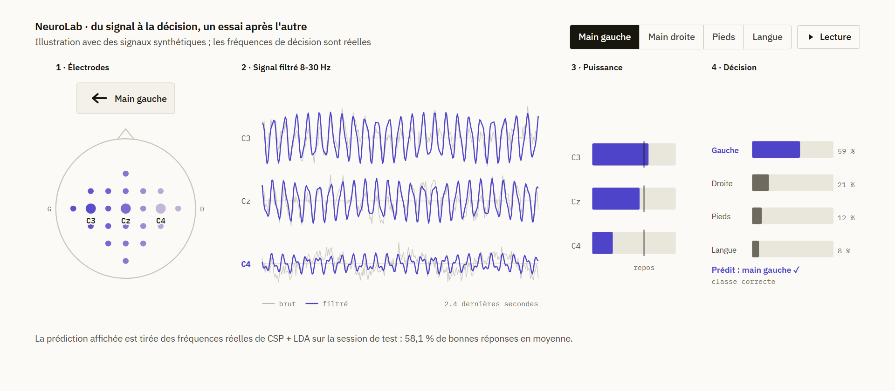
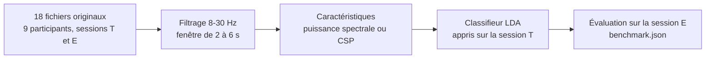

<p align="center">
  
</p>

<h1 align="center">NeuroLab</h1>

<p align="center">
  Reconnaître, à partir de 22 électrodes EEG, le mouvement qu'une personne imagine :<br>
  main gauche, main droite, pieds ou langue.
</p>

<p align="center">
  <a href="https://badreddine05.github.io/projets/neurolab/"><strong>Voir les résultats et les visualisations</strong></a>
  &nbsp;·&nbsp;
  <a href="https://badreddine05.github.io/">Portfolio</a>
</p>

<picture>
  <source media="(prefers-color-scheme: dark)" srcset=".github/readme/neurolab-dark.png">
  
</picture>

## Le projet

Quand on imagine bouger la main gauche, le rythme mu, une oscillation d'environ 10 Hz, faiblit au-dessus de l'hémisphère droit ; pour la main droite, c'est l'inverse. NeuroLab cherche ces traces dans le jeu public BCI Competition IV 2a et compare deux méthodes classiques d'imagerie motrice à une référence.

Le projet est né d'un travail d'équipe en master. Cette version le reprend avec un protocole plus strict : le modèle apprend sur une session d'enregistrement et il est évalué sur une autre, enregistrée un autre jour, sans qu'aucune étape du prétraitement ne voie les données de test.

## Résultats

Précision équilibrée sur la session de test des neuf participants, soit 2 592 essais d'apprentissage et autant de test :

| Méthode | Moyenne | Selon le participant | κ de Cohen |
| --- | ---: | ---: | ---: |
| Référence (classe majoritaire) | 25,0 % | 25,0 à 25,0 % | 0,00 |
| Puissance spectrale + LDA | 54,1 % | 30,9 à 67,7 % | 0,39 |
| CSP + LDA | 58,1 % | 34,0 à 77,1 % | 0,44 |

CSP + LDA fait mieux que la puissance spectrale pour sept participants sur neuf. Les écarts entre personnes sont grands : le participant 9 atteint 77,1 % de bonnes réponses, le participant 5 reste à 34 %. La colonne « selon le participant » donne le minimum et le maximum observés ; ce n'est pas un intervalle de confiance. Les matrices de confusion et le détail par participant sont dans `web/data/benchmark.json`.

## Comment ça marche



- Le jeu BNCI 2014-001 compte 9 participants, 22 électrodes EEG à 250 Hz et 4 classes, avec 288 essais par session.
- Chaque essai est filtré entre 8 et 30 Hz (Butterworth d'ordre 4, phase nulle), sur la fenêtre de 2 à 6 secondes après son début. Les canaux EOG ne sont pas utilisés.
- Tous les essais étiquetés sont gardés, y compris ceux que le fournisseur signale comme contenant des artefacts.
- CSP est appris en un-contre-tous, avec deux filtres par classe et une covariance régularisée. Les réglages sont fixés à l'avance : aucune recherche d'hyperparamètres ni sélection de modèle sur la session de test.

## Relancer l'évaluation

Il faut Python 3.13. Le téléchargement des 18 fichiers originaux représente environ 780 Mo ; leurs empreintes SHA-256 sont vérifiées.

```sh
python -m pip install -e ".[test]"
bci-lab --download
python -m pytest
```

`bci-lab` accepte aussi `--subjects 1 3 8` pour ne traiter que certains participants, `--raw-dir` pour indiquer où sont les fichiers et `--output` pour choisir le rapport produit. Sans `--download`, il ne télécharge rien.

| Chemin | Rôle |
| --- | --- |
| `src/bci_lab/` | Lecture des données, caractéristiques, évaluation et ligne de commande |
| `tests/` | Séparation des sessions, absence de fuite, structure du rapport |
| `data/sources.json` | URL, taille et empreinte de chaque fichier original |
| `web/data/benchmark.json` | Protocole, scores, matrices de confusion, qualité et provenance |
| `projetBCI.ipynb`, `projet_IAS.pdf` | Notebook et rapport de la première version, dont les scores ne sont pas comparables |

## Limites

- L'évaluation porte sur une nouvelle session d'une personne déjà vue. Elle ne dit rien d'une personne inconnue du modèle.
- Le système distingue quatre mouvements imaginés, en laboratoire. Il ne lit pas la pensée, et aucune validité clinique n'est revendiquée.
- Les signaux montrés dans les visualisations du portfolio sont synthétiques et présentés comme tels.

## Sources et crédits

Données : BNCI Horizon 2020, [jeu 001-2014](https://bnci-horizon-2020.eu/database/data-sets) (BCI Competition IV 2a), sous licence CC BY-ND 4.0. Le dépôt ne republie aucun enregistrement EEG : les fichiers sont téléchargés chez le fournisseur et restent dans `data/raw/`, ignoré par Git. Référence : Tangermann, M. et al. (2012). Review of the BCI Competition IV. *Frontiers in Neuroscience*, 6, 55. [doi:10.3389/fnins.2012.00055](https://doi.org/10.3389/fnins.2012.00055).

Équipe d'origine : James Camilleri, Badreddine Channoufi, Adam Sekkat et Victor Robert-Lambrecht. Reprise et réévaluation par [Badreddine Channoufi](https://badreddine05.github.io/), avec l'aide d'outils d'IA.

<details>
<summary>English summary</summary>

NeuroLab classifies four imagined movements (left hand, right hand, feet, tongue) from 22-channel EEG in BCI Competition IV 2a. Models are trained on one recording session and tested on another, recorded on a different day. Mean balanced accuracy over nine participants: 25.0 % for the majority baseline, 54.1 % for band power + LDA and 58.1 % for CSP + LDA, with large differences between participants.

</details>
